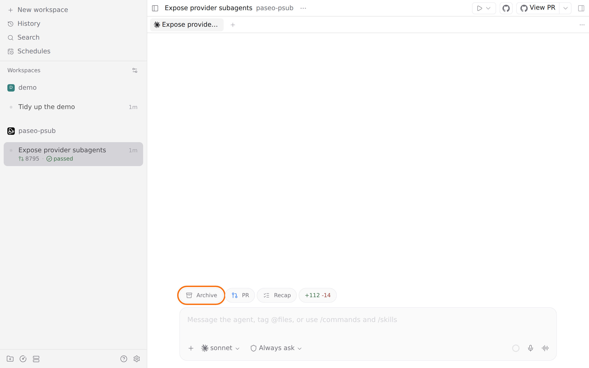

<p align="center"></p>

# Archive — a Paseo plugin

Adds an Archive button to every agent's composer. Pressing it archives the workspace that chat belongs to, the same as archiving it from the sidebar.



The button does not ask first. Archiving closes the workspace's agents and terminals, and you can restore the workspace from the archive afterwards.

The button shows only in chats with an existing agent, because Paseo does not draw plugin pills in a new-agent draft.

## Install

Requires Paseo 0.15.2 or later.

```bash
paseo plugin install https://github.com/puchkoff/paseo-archive
```

Or from a local clone: `paseo plugin install ./paseo-archive`. Check with `paseo plugin ls`.

## Develop

```bash
npm install
npm run typecheck
```

The in-app description shown by Paseo lives in [OVERVIEW.md](OVERVIEW.md).
